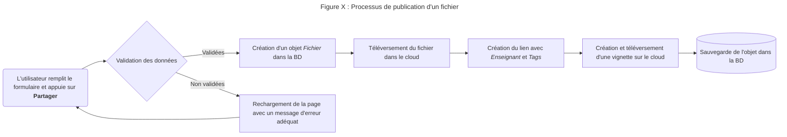
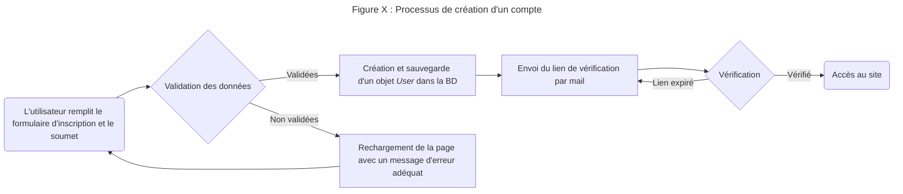

# La Caverne d'Ali Baba  <!-- omit from toc -->
**Alieldeen Ibrahim**  
Groupe 402

*COLLÈGE SISMONDI*, Travail de Maturité 2025-2027
Maître accompagnant : **Mathieu Schiess**

___

- [Introduction](#introduction)
- [Méthodologie](#méthodologie)
  - [Définition du projet et ses objectifs](#définition-du-projet-et-ses-objectifs)
  - [Choix des technologies](#choix-des-technologies)
    - [Django](#django)
    - [htmx et JavaScript](#htmx-et-javascript)
    - [Bootstrap et CSS](#bootstrap-et-css)
    - [PostgreSQL](#postgresql)
    - [AWS S3 Buckets](#aws-s3-buckets)
  - [Utilisation de l'IA](#utilisation-de-lia)
- [Réalisation](#réalisation)
  - [Publication des fichiers](#publication-des-fichiers)
    - [Organisation des données](#organisation-des-données)
    - [Point de vue utilisateur](#point-de-vue-utilisateur)
    - [Dans les coulisses](#dans-les-coulisses)
  - [Authentification utilisateur](#authentification-utilisateur)
    - [Inscription au site / Création d'un compte](#inscription-au-site--création-dun-compte)
      - [Point de vue utilisateur](#point-de-vue-utilisateur-1)
      - [Dans les coulisses](#dans-les-coulisses-1)
    - [Connexion et session](#connexion-et-session)
  - [Accès et téléchargement des fichiers](#accès-et-téléchargement-des-fichiers)
    - [Point de vue utilisateur](#point-de-vue-utilisateur-2)
    - [Recherche et *Auto-suggestion* (suggestion semi-automatique)](#recherche-et-auto-suggestion-suggestion-semi-automatique)
    - [Filtrage et affichage des résultats](#filtrage-et-affichage-des-résultats)
    - [Affichage et téléchargement des fichiers](#affichage-et-téléchargement-des-fichiers)
- [La suite](#la-suite)
  - [Système de recherche](#système-de-recherche)
  - [Formats de fichiers acceptés et leur affichage](#formats-de-fichiers-acceptés-et-leur-affichage)
  - [L'aspect visuel du site](#laspect-visuel-du-site)
  - [Modération](#modération)
  - [Tests automatisés](#tests-automatisés)
- [Conclusion](#conclusion)
- [Glossaire](#glossaire)
- [Bibliographie](#bibliographie)
- [Annexe](#annexe)
  - [Prompt 1 — Correction linguistique du rapport](#prompt-1--correction-linguistique-du-rapport)
  - [Prompt 2 — Conversion et mise en page du rapport](#prompt-2--conversion-et-mise-en-page-du-rapport)
- [Un message final](#un-message-final)

---

<br>

# Introduction

À travers mon parcours scolaire, j'ai fait face aux évaluations (et j'y fais encore face), c'est malheureusement inévitable.

Un des problèmes que je rencontre lors de la révision est de ne pas savoir par où commencer, car certains enseignants distribuent soit beaucoup soit peu de fichiers qui consistent souvent en articles dont le lien n'est pas clair, c'est le cas pour la géographie et l'histoire. La solution évidente est d'avoir pris de bonnes notes, mais celle-ci n'est pas simple, surtout quand le sujet ne m’intéresse pas, et il ne sert plus à rien de s'attarder sur le passé quand le contrôle approche.

Un deuxième problème que je rencontre lors de la révision est de ne pas avoir assez d'exercices. Certains enseignants donnent deux ou trois problèmes par sujet, c'est le cas pour la physique. D'autres sujets méritent toujours plus d'exercices même si on en a déjà fait mille, comme les intégrales en maths qui ne se résolvent pas toujours de la même manière. Une réponse peut être qu'un enseignant ne mettra pas de problèmes qu'on n'a jamais eus en cours. C'est généralement vrai, mais à mon avis, s'exercer sur des questions qu'on n'a pas vues avant garde le cerveau frais, donne beaucoup plus de facilité à faire les exercices qu'on a déjà vus et permet de voir d'autres manières de les résoudre. Toutefois, il faut aimer le sujet, sinon cela devient vite fastidieux.

La solution que j'ai trouvée aux deux problèmes est de demander aux autres. À chaque évaluation, je demande toujours à mes camarades, à ceux qui ont un autre enseignant ou même à d’anciens élèves de m'envoyer leurs fichiers, notes et exercices. J'ai ensuite remarqué que je ne suis pas le seul à faire ceci. Voici un exemple : au 2e semestre de la 3e année, nous avions un oral de physique et un autre d'applications des maths pour les épreuves regroupées. À ce moment-là, un groupe WhatsApp ainsi qu'un drive Google ont été créés, dans le but de partager des fichiers et de s’entraider. Cette solution est bien sûr valable, mais selon les cas, on n'a pas toujours des camarades à contacter.

Je me suis donc posé la question suivante : N'existe-t-il pas de moyen de partage qui ne demande pas la connaissance et le contact de tout un tas de monde ? Après un peu de recherche, je n'en ai pas trouvé qui corresponde à mes besoins. Je connaissais déjà un site de partage de documents qui s'appelle [*Scribd*](https://www.scribd.com), et il en existe beaucoup d'autres. Les problèmes avec ce dernier sont qu'il contient des fichiers très divers, et surtout qu'il est payant quand on veut télécharger les documents. Pour un étudiant, un site payant n'est pas du tout attirant.

Étant donné que la programmation m'intéresse bien, j'ai décidé de remédier moi-même à ce problème et de créer une plateforme de partage de fichiers scolaires gratuite pour les étudiants du collège de Genève. Ce projet sert non seulement à répondre à un besoin scolaire, mais à m'apporter une expérience plutôt complète de création de site web de A à Z, quelque chose d'assez important si on envisage une carrière dans l'informatique avec l'essor de l'IA.

Avant de poursuivre la lecture, je vous encourage à découvrir le site, accessible à l'adresse suivante : [https://lacaverne.app/](https://lacaverne.app/). Vous pouvez aussi jeter un coup d'œil sur le code source qui est disponible sur GitHub : [https://github.com/Zbebz/caverne-dAli-baba](https://github.com/Zbebz/caverne-dAli-baba).

---

# Méthodologie

Je suis un simple collégien de 17-18 ans. Je fais de la programmation depuis l'âge de 12 ans ; c'était la pandémie et je devais bien faire quelque chose de ma vie. Cependant, je n'ai jamais créé de projet de ma propre ingénierie. J'étais donc perdu lorsqu'il a fallu commencer le travail. Pour pouvoir trouver une piste vers laquelle j'allais me diriger, j'ai fait une recherche rapide sur Internet sur la manière de planifier un projet informatique. J'ai trouvé un [post](https://www.reddit.com/r/learnprogramming/comments/mumrgn/how_to_plan_and_build_a_programming_project_a/) sur Reddit donnant des étapes pour ce faire. Je n'ai pas suivi toutes les étapes, mais j'en ai pris l'essence. Dans ce chapitre, j'explique la démarche que j'ai suivie afin de concevoir le site web, ainsi que les choix des outils utilisés.

## Définition du projet et ses objectifs

J'ai nommé le site **La Caverne d'Ali Baba** en référence au conte d'Ali Baba et les Quarante Voleurs, dans lequel une caverne renferme de nombreux trésors. Je souhaite que mon site joue un rôle similaire : réunir en un seul endroit des ressources scolaires précieuses pour les collégiens.

Au début, j'ai commencé par définir le *MVP* (*Minimum Viable Product*). Un *MVP* est la version la plus minimale d'un produit ou d'une fonctionnalité. Il s'agit d'implémenter seulement ce qui est nécessaire pour que l'application fonctionne bien et ensuite de commencer à l'améliorer. Le but est donc de concevoir le produit le plus rapidement possible afin de pouvoir le montrer au monde et ensuite d'avoir des retours. En bref, il s'agit d'une version provisoire, mais qui fonctionne bien.[^mvp]

[^mvp]: WIKIPEDIA CONTRIBUTORS. Minimum viable product. Wikipedia, The Free Encyclopedia [en ligne]. Version 15 mai 2026. [Consulté le 20 mai 2026]. Disponible à l'adresse : https://en.wikipedia.org/w/index.php?title=Minimum_viable_product&oldid=1354312482

J'ai défini le *MVP* de la manière suivante : un site web sur lequel les utilisateurs, qui sont les collégiens de Genève, peuvent partager/publier des fichiers scolaires. C'est l'essentiel du site. Ces utilisateurs doivent pouvoir créer un compte, se connecter et se déconnecter. Ceci permet d'identifier les utilisateurs et de réguler l'accès au site. Les fichiers partagés doivent être accessibles à tout utilisateur authentifié, à l'aide d'un système de recherche et de filtrage afin de trouver un résultat satisfaisant, et téléchargeables. Selon moi, cette définition permet de créer la version la plus minimaliste du site. Elle me donne un but vers lequel je m'oblige à m'orienter afin d'obtenir une version utilisable du site. Il y a certaines choses que je n'ai pas mises dans la définition, principalement tout ce qui concerne le style du site, car l'aspect fonctionnel du site est plus important que l'aspect visuel. Ceci ne signifie pas qu'il est futile ; un bon style du site améliore fortement l'expérience utilisateur.

## Choix des technologies

### Django

Pour ce projet, je savais que j'allais apprendre beaucoup de programmation. De ce fait, j'ai décidé de me rendre la tâche plus facile en choisissant Python comme langage principal, car c'est celui que je connais le plus. Ce choix a été pas mal controversé parmi mes amis, qui m'ont demandé pourquoi ne pas utiliser JavaScript. Leur question est tout à fait valide et me met parfois dans le doute. JavaScript est un langage très populaire dans le monde du web sur lequel une quantité énorme de *frameworks* est basée (React, Vue, Angular, Svelte, etc.). Ma réponse est que je ne suis pas à l'aise avec JavaScript.

Pour Python, il existe 2 *frameworks* populaires : Django et Flask. Le choix s'est basé sur deux critères : les fonctionnalités proposées nativement et mon degré de familiarité avec chacun d'eux. Pour ce qui concerne les fonctionnalités, Django intègre nativement plus de fonctionnalités que Flask. Avoir ces mêmes fonctionnalités dans Flask nécessite l'installation et l'apprentissage de librairies en plus. Pour ce qui concerne mon degré de familiarité, je ne connaissais ni la syntaxe ni le système de Django, donc il fallait regarder des vidéos et lire des articles. J'ai déjà utilisé Flask dans un cours d'informatique. Mon choix final est Django. Au-delà de ses fonctionnalités, j'avais envie d'apprendre Django, donc le choix n'a pas été tout à fait objectif.

### htmx et JavaScript

Certaines fonctionnalités du site nécessitent une interactivité sans rechargement. La solution fréquente est d'utiliser JavaScript. Si on a envie de mettre à jour une certaine information provenant de la BD[^bd] sur une page sans recharger la page, il faut envoyer des requêtes `HTTP` depuis JavaScript et traiter leurs réponses, ce qui ajoute de la complexité au code du site. Afin d'éviter ceci, j'utilise la librairie JavaScript `htmx`. Elle permet d'envoyer des requêtes `HTTP` directement à partir d'éléments HTML et de remplacer une partie de la page par la réponse du serveur. Toutefois, JavaScript est utilisé pour les modifications qui ne font pas intervenir des requêtes `HTTP`.

[^bd]: Pour des raisons de brièveté et de légèreté de lecture, BD signifie base de données.

### Bootstrap et CSS

Au début, j'ai choisi d'utiliser Bootstrap, un *framework* CSS qui fournit des composants et des styles prédéfinis permettant de créer rapidement une interface, pour l'interface générale et CSS pour les petites modifications. C'est un choix qui m'a posé beaucoup de problèmes lors du développement du site, et que je regrette. J'ai découvert que Bootstrap ne me convient pas et ne possède pas tout ce dont j'ai besoin, donc je finis quand même par écrire plus de CSS que voulu, ce qui devient vite fastidieux. Il est très probable que je cesserai d'utiliser Bootstrap et commencerai à utiliser Tailwind, un autre *framework* CSS qui fournit des classes utilitaires et qui donne plus de contrôle que Bootstrap, dans les prochaines versions.

### PostgreSQL

Dès le départ, j'ai décidé de prendre PostgreSQL comme BD. À ce moment-là, c'était un choix arbitraire. Quand mon maître accompagnant m'a demandé "Pourquoi pas MySQL ?", j'ai répondu que je préfère les éléphants aux dauphins.[^elephants] Au début du développement, j'ai gardé SQLite, la BD par défaut avec Django, pour des raisons de simplicité. Quand il a fallu développer la fonctionnalité de recherche, j'ai découvert plusieurs outils utiles dans PostgreSQL. Je parle plus en profondeur de ces outils dans le sous-chapitre [**Recherche et *Auto-suggestion* (suggestion semi-automatique)**](#recherche-et-auto-suggestion-suggestion-semi-automatique).

[^elephants]: La mascotte de PostgreSQL est un éléphant. Celle de MySQL est un dauphin.

### AWS S3 Buckets

Je stocke les documents sur ce service au lieu du serveur car il permet une séparation de tâches où le serveur s'occupe seulement du programme et de la conservation des métadonnées des fichiers dans la BD et le service s'occupe de la conservation des fichiers. Cette organisation allège le travail du serveur, car leur téléchargement ne nécessite pas de transit à travers le serveur. Plus encore, en cas d'augmentation du nombre de serveurs hébergeant l'application, ils pourront tous communiquer avec le service au lieu de chercher dans chacun où se trouve un certain fichier. Je stocke sur un bucket dans la région AWS Europe (Zurich) pour assurer la rapidité.

## Utilisation de l'IA

Pour la création du site, je n'ai utilisé l'IA que lorsque je ne trouvais pas de solution sur Internet. Par exemple, lors du déploiement, j'ai eu un problème où le site n'était plus en ligne. Étant donné que c'était la première fois que je déployais un site web, j'ai eu recours à l'IA pour m'aider avec ce problème. Chaque fois que j'utilisais l'IA, j'essayais de comprendre la solution qu'elle proposait.

Ce rapport est écrit au format markdown que vous pouvez trouver sur le dépôt GitHub hébergeant le code du site.  Ce format me permet d'écrire dans le même environnement que j'utilise pour la programmation. Je n'ai donc pas à utiliser plusieurs logiciels en même temps lorsque je travaille sur le projet. Puisqu'il faut une version pdf de ce rapport, j'ai eu recours à l'IA pour la conversion de markdown en pdf, car je n'ai pas trouvé de convertisseur adéquat sur Internet. De plus, les captures d'écran qu'on voit dans le chapitre suivant sont prises par moi-même, mais ensuite ajoutées lors de la conversion. J'ai également utilisé l'IA pour corriger les fautes de langue et de grammaire dans le rapport, puisque la langue française n'est pas ma langue maternelle. L'IA utilisée pour faire ceci est ChatGPT. Vous trouverez les prompts utilisés dans l'[annexe](#annexe).

Le logo du site, qui se trouve sur la couverture, a été créé par Claude et puis modifié personnellement. Je ne retrouve plus la conversation qu'il y a eu pour arriver à ce résultat.

---

# Réalisation

Dans ce chapitre, j'explique comment j'ai implémenté le site web. Je présente les principales fonctionnalités : la publication des fichiers, l'authentification des utilisateurs et enfin l'accès aux ressources et leur téléchargement à travers le système de recherche.

## Publication des fichiers

La première fonctionnalité que j'ai implémentée est celle de la publication et du partage des fichiers, car selon moi, il s'agit du cœur de l'application. C'est la fonctionnalité qui donne à l'utilisateur la possibilité de partager ses documents avec le monde.

Afin de comprendre certains éléments qui arrivent plus tard dans le rapport, il faut savoir comment Django gère la BD. Django utilise la technique d'*ORM* (*Object-relational mapping*) pour gérer les données. Dans cette technique, on associe les tables d'une BD à des classes, donc chaque colonne de la table est représentée par une propriété de la classe et chaque ligne de la table est représentée par une instance de la classe, d'où "*mapping*" dans *Object-relational mapping*. Cette technique ne fonctionne bien sûr qu'avec les langages de programmation orientée objet, ce qui est le cas de Python. La table d'une BD est appelée un modèle (*model* en anglais) dans le monde de Django. Réellement, un modèle est une classe Python associée à une table d'une BD. La technique d'*ORM* permet au développeur de pouvoir se concentrer sur seulement un langage lors de la conception de son projet au lieu de devoir s'occuper d'un autre, SQL, ce qui accélère le développement. De plus, les *ORMs* (*Object-relational mapper*)[^orm-orm] améliorent la sécurité en réduisant fortement le risque d'attaques du type *SQL injection*[^SQLi], et en évitant de faire un *Bobby Tables*[^bobby-tables]. Cependant, les requêtes générées avec un *ORM* peuvent être moins optimisées que celles en *Raw SQL*.

[^orm-orm]: Il est important de différencier *Object-relational mapping*, c'est-à-dire la technique, et *Object-relational mapper*, c'est-à-dire l'outil qui nous fait utiliser la technique.

[^SQLi]: Une attaque *SQL injection* se fait quand une personne malveillante tape du SQL dans un champ de saisie, et ensuite ce SQL est mis dans la requête SQL du programme à l'aide de la concaténation, ce qui fait une requête qui va lui donner accès aux données dans la base. Vous pouvez vous informer plus ici : [https://www.w3schools.com/SQl/sql_injection.asp](https://www.w3schools.com/SQl/sql_injection.asp)

[^bobby-tables]: En 2007, xkcd a publié un comic avec un personnage dont le prénom a effectué une attaque *SQL injection*. [https://xkcd.com/327/](https://xkcd.com/327/)


### Organisation des données

Tout d'abord, j'ai commencé par créer la BD. L'une des difficultés qui se pose lors de l'implémentation de cette fonctionnalité est celle de savoir et de décider quelles informations un utilisateur doit entrer avec le téléversement du fichier. Ces informations doivent être stockées dans la BD de manière structurée afin de pouvoir s'en servir plus tard pour la recherche des fichiers.

```mermaid
---
title: "Figure X : Schéma de la BD"
config:
  theme: redux-color
  look: neo
---
erDiagram
    direction LR
    USER {
        int id PK
        autres propriétés...
    }

FICHIER {
        uuid id PK
        int user_id FK
        int enseignant_id FK
        string name
        string file
        string thumbnail "vignette"
        int year "degré"
        string subject
        string type "évaluation, exercices, etc."
        string ecole
        boolean annotated
        text description
        int status "chargé, en attente, rejeté"
        datetime uploadDatetime
    }

    ENSEIGNANT {
        int id PK
        string name
        string ecole
    }

    TAG {
        int id PK
        string name
    }

    USER ||--o{ FICHIER : publie
    ENSEIGNANT ||--o{ FICHIER : concerne
    FICHIER }o--o{ TAG : possède
```
<!-- SOUS-LÉGENDES DE LA FIGURE PRÉCÉDENTE
PK : *Primary Key* (Clé primaire)
FK : *Foreign Key* (Clé étrangère)
UUID : *Universally unique identifier* (Identifiant unique universel)
-->
<br/>

On peut voir dans ce diagramme[^diagram] toutes les relations entre modèles dans la BD. Quand un *user* publie des fichiers, en mentionnant l'enseignant concerné, plusieurs relations sont établies dans la BD. La relation entre `User` et `Fichier` et celle entre `Enseignant` et `Fichier` s'appellent des relations *one-to-many* (un-à-plusieurs) ; un utilisateur peut avoir plusieurs fichiers, mais un fichier n'appartient qu'à un utilisateur. On associe à chaque fichier un ou plusieurs *tags* (mots clés), qui aident plus tard à la recherche de ces documents. Cette relation s'appelle *Many-to-many* ; un *tag* peut être associé à plusieurs fichiers et un fichier peut avoir plusieurs *tags*. Il est important de savoir que pour avoir une relation *many-to-many* (plusieurs-à-plusieurs), il y a besoin d'une table de plus qui n'a pas de modèle associé, elle sert juste de pont entre les deux. Cette table est créée par défaut par l'*ORM* de Django, mais on peut aussi créer la sienne.

Au départ, `tags` était une chaîne de caractères et non un objet dans un autre modèle. J'ai essayé d'utiliser le type *array* (liste ou tableau) de PostgreSQL, mais je n'ai pas pu m'en servir pour la recherche plus tard. La solution était de mettre les mots clés dans une table à part.

[^diagram]: Le markdown écrit pour concevoir ce diagramme a été créé le 13 septembre 2026 à l'aide de ChatGPT. Le fichier contenant les modèles lui a été donné afin qu'il me donne le markdown nécessaire. J’ai ensuite modifié le diagramme selon mes besoins

Pour les écoles, matières, types de fichier et années, je n'ai pas créé de modèle. J'ai utilisé des *enums*[^enum], car ces valeurs sont toujours constantes, ne changeront jamais, et il n'y en a pas beaucoup. Pour les enseignants, j'ai prévu d'utiliser ce même outil. Cependant, j'ai dû faire un modèle `Enseignant` car je ne possède pas de liste contenant tous les enseignants de tous les collèges de Genève. À chaque publication d'un fichier, un enseignant ne figurant pas déjà dans la BD est ajouté. Ceci signifie qu'avec un grand nombre d'utilisateurs et de fichiers téléversés sur le site, je peux avoir une telle liste.

[^enum]: "En programmation informatique, un type énuméré (appelé souvent énumération ou juste enum, parfois type énumératif ou liste énumérative) est un type de données qui consiste en un ensemble de valeurs constantes. Ces différentes valeurs représentent différents cas ; on les nomme énumérateurs. Lorsqu'une variable est de type énuméré, elle peut avoir comme valeur n'importe quel cas de ce type énuméré." (CONTRIBUTEURS DE WIKIPÉDIA. Type énuméré. Wikipédia, l'encyclopédie libre [en ligne]. Version 20 février 2024. [Consulté le 14 septembre 2026]. Disponible à l'adresse : https://fr.wikipedia.org/wiki/Type_%C3%A9num%C3%A9r%C3%A9)

### Point de vue utilisateur

<!-- IMAGES
Fichiers: pub_1.png, pub_2.png, pub_3.png, pub_4.png, pub_5.png, pub_6.png
Disposition: grille 2 colonnes × 3 lignes
Ordre: de gauche à droite, puis de haut en bas
Légende générale: Figure X : Étapes de publication d'un fichier sur le site.
Sous-légendes:
1. Accès à la page de publication
2. Sélection d'un fichier
3. Dépôt du fichier PDF
4. Affichage du formulaire
5. Saisie des informations
6. Publication du fichier
-->

Au début, j'envisageais le formulaire de publication différemment. Je pensais mettre tous ses champs à la suite sans qu'il y ait de séparation ou de transition. Après l'avoir montré à certains de mes amis et avoir regardé des inspirations en ligne, je me suis aperçu que cette mise en page est assez lourde. Je l'ai ensuite refaite telle qu'elle est dans la figure X. J'ai implémenté la méthode glisser-déposer (*drag and drop*) qui est fréquemment utilisée dans les sites où il faut un dépôt de fichier. Elle permet une certaine fluidité au site. L'utilisateur peut tout de même charger un fichier en cliquant dans le carré. Ensuite, l'utilisateur remplit le reste du formulaire et le soumet. À la fin, il retourne à la page d'accueil.

<!-- IMAGE
Fichier: pub_error.png
Légende: Figure X : Exemple de validation du formulaire lorsqu’un champ obligatoire n’est pas renseigné
Disposition: à droite, inclus avec le reste du texte
-->
Comme on peut le voir dans la figure X, un message apparaît rappelant à l'utilisateur de remplir le champ en cas d'oubli.

<!-- IMAGE
Fichier: pub_supposed.png
Légende: Figure X : Maquette conçue pour l’interface de publication avant son implémentation
Disposition: à droite, inclus avec le reste du texte
-->
L'espace vide à droite qu'on voit dans la figure X-2 est censé être remplacé par une carte, qu'on peut voir dans la figure X, montrant à quoi ressemblera le fichier dans les résultats d'une recherche. Le carré vide dans la carte sera remplacé par une vignette du fichier. Ceci est en cours de développement.

### Dans les coulisses

<br/>

Le processus de publication d'un fichier est très simple grâce à Django. Quand un utilisateur partage un fichier, la validation des données, c'est-à-dire la vérification qu'elles sont bien remplies et du bon type, est effectuée par Django qui regarde les critères qui ont été déclarés lors de la création du modèle. De plus, la création d'un objet `Fichier` ainsi que son lien avec la BD sont assurés par l'*ORM* de Django. Tous les fichiers et leurs vignettes sont finalement stockés sur un bucket AWS S3.

## Authentification utilisateur

La deuxième fonctionnalité que j'ai décidé d'implémenter est l’authentification utilisateur. L'authentification utilisateur est très importante pour l'application car elle permet de vérifier si l'utilisateur est bien un étudiant du Collège de Genève et de lui autoriser l'accès. Ainsi, l'utilisateur doit pouvoir créer son propre compte, vérifier son adresse mail, se connecter afin de s'authentifier et pouvoir accéder à la caverne.

Un des avantages de Django est son système d'authentification. Django possède déjà un modèle `AbstractUser` qui contient toutes les propriétés nécessaires pour sauvegarder un utilisateur, telles que l'identifiant et le mot de passe, et auquel j'ai ajouté une propriété `ecole` qui contiendra le collège auquel appartient l'utilisateur.

### Inscription au site / Création d'un compte

#### Point de vue utilisateur

<!-- IMAGES
Fichiers: in_1.png, in_2.png, in_3.png, in_4.png, in_5.png, in_6.png, in_7.png
Disposition: processus en 7 étapes, grille compacte adaptée à la page
Ordre: de gauche à droite, puis de haut en bas
Légende générale: Figure X : Étapes de création d'un compte sur le site.
Sous-légendes:
1. Accès à la page d'inscription depuis la page de connexion.
2. Formulaire de création d'un compte.
3. Saisie des informations et envoi du formulaire.
4. Demande de vérification de l'adresse eduge.
5. Réception du courriel contenant le lien de vérification.
6. Confirmation de la vérification du compte.
7. Accès au site après vérification.
-->
Les étapes de création d'un compte sont simples et directes. Étant donné que c'est une fonctionnalité présente dans quasiment toutes les applications et qu'elle est toujours implémentée de la même manière, il n'y a pas eu beaucoup de réflexion à faire concernant le fonctionnement général de l'inscription. J'ai regardé comment ces applications la gèrent et je l'ai recréée dans le site, car un changement peut dérouter les utilisateurs.

<!-- IMAGES
Fichiers: in_id.png, in_pass.png
Disposition: 2 images côte à côte.
Légende générale: Figure X : Exemples de validation des données lors de la création d'un compte.
Sous-légendes:
1. Refus d'un identifiant eduge déjà utilisé.
2. Refus d'un mot de passe ne respectant pas les critères de sécurité.
-->
La figure X.1 nous montre le message d'erreur qui apparaît lorsqu'on essaie de s'inscrire avec un identifiant déjà utilisé. Ceci évite de potentiels conflits dans la BD.

La figure X.2 nous montre le message d'erreur qui apparaît lorsqu'un utilisateur utilise un mot de passe court. Avoir une longueur minimale protège les utilisateurs contre les attaques par force brute.

La vérification par mail est une méthode de confirmation d'identité qui sert principalement à s'assurer que la personne qui est en train de créer le compte est bien la personne qu'elle prétend être et à éviter toute tentative de fraude ou d'usurpation d'identité. Toutefois, j'ai décidé de l'implémenter car elle sert à vérifier que la personne est bien un étudiant au collège de Genève, qui possède donc un compte eduge[^eduge]. Le programme envoie un mail de vérification à `<identifiant eduge saisi>@eduge.ch`. Il existe donc 3 possibilités suite à la soumission du formulaire :
1. la personne s'est inscrite avec un identifiant eduge invalide. Elle ne recevra jamais le mail et ainsi n'aura jamais accès au site.
2. la personne s'est inscrite avec un identifiant eduge valide mais qui ne lui appartient pas. Elle n'a normalement[^verify-2] pas accès au mail, donc elle n'aura pas accès au site.
3. la personne s'est inscrite avec un identifiant eduge valide lui appartenant. Elle pourra donc cliquer sur le lien de vérification envoyé et ensuite accéder au site.

[^eduge]: Techniquement, avoir un compte eduge n'est pas restreint aux collégiens ; les enseignants en possèdent aussi un. J'ai choisi de garder l'accès des enseignants au site.

[^verify-2]: Je dis "normalement" car elle peut y avoir accès à cause d'une cyberattaque, mais la cybersécurité du système EEL dépasse le cadre de ce projet.

<!-- IMAGE
Fichier: ver_expired.png
Légende: Figure X : Message affiché lorsqu'un utilisateur tente d'utiliser un lien de vérification expiré.
Disposition: à droite, inclus avec le reste du texte
-->
Le lien de vérification est valide pendant 24 h avec la possibilité d'en générer un autre afin de donner quand même une chance en cas d'oubli (Figure X). Ce qui assure l'unicité du lien, c'est que son *token* dépend d'une certaine information de l'utilisateur, du temps et de la clé secrète de l'application[^secret-key].

[^secret-key]: "La clé secrète d’une installation Django. Elle est utilisée dans le contexte de la signature cryptographique, et doit être définie à une valeur unique et non prédictible." (DJANGO SOFTWARE FOUNDATION, 2025. Réglages. Django (Version 6.0) [en ligne]. [Consulté le 16 septembre 2026]. Disponible à l'adresse : https://docs.djangoproject.com/fr/6.0/ref/settings/#std-setting-SECRET_KEY)

#### Dans les coulisses


<br/>

De même que pour le processus de publication d'un fichier, le processus de création d'un compte bénéficie du système de formulaire de Django. Ainsi, la validation des données, qui consiste à vérifier l'unicité de l'identifiant et la sécurité du mot de passe, est effectuée par Django ainsi que la création du compte et sa sauvegarde dans la BD. Il est important de savoir que Django ne stocke pas les mots de passe en tant que tels, mais les stocke hachés, pour mieux protéger les mots de passe en cas d’accès à la BD.

### Connexion et session

La connexion et la session sont gérées par Django sans grande modification ni ajout de ma part. Une session, qui est créée suite à la connexion d'un utilisateur, me permet d’identifier l’utilisateur connecté. Lors de la publication, j’associe l'utilisateur qui a publié un fichier au fichier publié. De plus, elle maintient la connexion de l'utilisateur même après la fermeture de l'onglet.

<!-- IMAGES
Fichiers: con_1.png, con_2.png, con_3.png
Disposition: séquence de 3 images montrant le processus de connexion.
Légende générale: Figure X : Étapes de connexion au site.
Sous-légendes:
1. Formulaire de connexion.
2. Saisie de l'identifiant eduge et du mot de passe.
3. Accès au site
-->
Pareillement à la création du compte, la connexion a été implémentée de manière conventionnelle pour que l'expérience utilisateur soit la même que dans la majorité des applications et pour éviter des confusions.

<!-- IMAGES
Fichiers: con_pass.png, con_verify.png
Disposition: 2 images côte à côte.
Légende générale: Figure X : Exemples de validation des données lors de la connexion de l’utilisateur.
Légende: Figure X : Message affiché lorsqu'un utilisateur tente de se connecter avec un identifiant non existant ou un mot de passe incorrect.
Sous-légendes:
1. Refus d'un identifiant non existant ou d'un mot de passe incorrect.
2. Refus de la connexion lorsque les identifiants sont corrects, mais que le compte n'a pas encore été vérifié par mail.
-->
En cas de saisie de mauvaises informations, l'utilisateur voit le message dans la figure X.1.

En cas de non-vérification du compte, l'utilisateur voit le message dans la figure X.2. C'est ici que la vérification utilisateur devient importante. Tant que l'utilisateur n'a pas validé le lien reçu sur son adresse eduge, le site ne peut pas confirmer qu'il a accès à cette adresse et lui refuse donc la connexion.


## Accès et téléchargement des fichiers

Finalement, la dernière fonctionnalité que j'ai implémentée est le système de recherche des fichiers. Suite à leur publication, il est important que l'utilisateur puisse y accéder et les télécharger ; c'est l'objectif de l'application. Cependant, avec l'augmentation du nombre de fichiers (ce qui, je l'espère, va arriver) sur l'application, il devient presque impossible de trouver ce que l'on veut. Afin de résoudre ce problème, il faut mettre un système de recherche efficace qui permettra à l'utilisateur de trouver ce dont il a besoin sans problème. C'est ici qu'on se sert de l'organisation des données dans la BD (cf. [Organisation des données](#organisation-des-données)).

### Point de vue utilisateur

<!-- IMAGES
Fichiers: se_1.png, se_2.png, se_3.png, se_4.png, se_5.png
Disposition: processus en 5 étapes, grille compacte adaptée à la page
Ordre: de gauche à droite, puis de haut en bas.
Légende générale: Figure X : Étapes de recherche et d'accès à un fichier.
Sous-légendes:
1. Page d'accueil et barre de recherche.
2. Affichage d'une suggestion lors de la saisie.
3. Affichage des fichiers correspondant à la recherche.
4. Filtrage selon le besoin.
5. Affichage d'un fichier et possibilité de le télécharger.
-->

Quand l'utilisateur ouvre le site en s'étant déjà connecté, il trouve directement la barre de recherche devant lui, ce qui lui facilite la tâche, car il n'a pas à la chercher ailleurs. Pour chercher ce dont il a besoin, l'utilisateur écrit des mots clés, les mêmes qui ont été inscrits lors de la publication.

J'ai choisi un affichage des fichiers sous forme de cartes car il me permet de présenter quelques informations essentielles : titre, école, matière, degré et une vignette du fichier (qui a été créée lors de la publication), de manière concise et propre. Il permet à l'utilisateur de comparer les fichiers rapidement pour en trouver un qui est satisfaisant, comme s'il faisait du shopping sur une boutique en ligne.

<!-- IMAGES
Fichiers: se_no1.png, se_no2.png
Disposition: 2 images côte à côte.
Légende générale: Figure X : Une recherche qui ne donne aucun résultat.
Sous-légendes:
1. Recherche d'un terme ne correspondant à aucune ressource.
2. Affichage du message indiquant qu'aucun résultat n'a été trouvé.
-->
Quand un utilisateur tape un mot clé qui n'existe pas dans la BD, il ne voit aucune suggestion lors de la recherche, ce qui devrait sous-entendre qu'il n'existe pas de fichiers remplissant ses besoins. S'il décide tout de même de chercher, il voit un message le lui disant. Nous verrons cependant dans le sous-chapitre suivant que n'avoir aucune suggestion ne signifie pas forcément, dans l'état actuel du site, la non-existence de fichiers satisfaisants.

### Recherche et *Auto-suggestion* (suggestion semi-automatique)

L'*auto-suggestion* est une fonctionnalité qui "prédit" et montre à l'utilisateur des fins possibles à ce qu'il est en train d'écrire lors de sa recherche. J'ai décidé de l'implémenter car elle lui permet de gagner en rapidité et rend sa requête plus précise. L'implémentation a commencé par le changement de BD de SQLite à PostgreSQL. Dans PostgreSQL, il est possible de faire une recherche par *Trigram similarity*[^trigram] à l'aide du module `pg_trgm`, ce qui rend la tâche très fluide. Étant donné que la langue française fait usage des accents, il est important que les résultats ne dépendent pas de leur présence, car les accents ne sont pas toujours mis lors de la recherche. Pour ce faire, il existe un autre module `unaccent` dont la seule fonction est d'enlever les accents. Ces 2 modules sont propres à PostgreSQL.

<!-- IMAGE
Fichier: se_prob.png
Légende: Figure X : Absence de suggestion pour "naths".
Disposition: à droite, inclus avec le reste du texte
-->
Après quelques tests, je me suis aperçu que la méthode *Trigram similarity* ne donne pas toujours des résultats. Dans la figure X, on a tapé "naths" au lieu de "maths" et il n'y a pas de mots clés suggérés, malgré le fait qu'il s'agisse d'un remplacement d’une lettre par une lettre voisine sur un clavier QWERTZ suisse. J'ai trouvé que c'est un problème de seuil de similarité. La fonction dans le module PostgreSQL ne rend que les mots qui ont un score de similarité plus grand qu'un certain seuil prédéfini. Le problème survient principalement avec les mots courts car il y a moins de trigrammes. Ma solution est de baisser ce seuil pour que la recherche soit moins restrictive. La nouvelle valeur pour le seuil a été déterminée grâce à plusieurs tests qui font intervenir des fautes de frappe dans des mots de longueurs diverses.

[^trigram]: "Un trigramme est un groupe de trois caractères consécutifs extraits d’une chaîne de caractères. Il est possible de mesurer la similarité entre deux chaînes en comptant le nombre de trigrammes qu’elles ont en commun. Cette idée simple s’avère très efficace pour mesurer la similarité entre des mots dans de nombreuses langues naturelles." (POSTGRESQL. pg_trgm — support for similarity of text using trigram matching. PostgreSQL [en ligne]. [Consulté le 14 septembre 2026]. Disponible à l'adresse : https://www.postgresql.org/docs/current/pgtrgm.html) Traduit de l'anglais en français avec Google Traduction.

Bien souvent, l'utilisateur peut changer le contenu de la barre de recherche. Quand l'utilisateur tape dans la barre de recherche ou change son contenu, il est préférable que les suggestions apparaissent ou changent sans rechargement de page, pour lui donner une sensation de dynamisme. C'est ici qu'intervient htmx (cf. [htmx et JavaScript](#htmx-et-javascript)). Dans le cas de cette application, htmx envoie une requête à Django avec le contenu de la barre de recherche, Django fait sa magie[^magie] et envoie un fragment de HTML avec les résultats (qui sont les suggestions), et htmx le remplace directement dans le *DOM*[^dom] au lieu de recharger la page, le tout à l'aide d'attributs HTML. Sans htmx, il aurait fallu coder en JavaScript la détection de la modification de la barre de recherche, l'envoi de la requête, la récupération de la réponse et la modification du *DOM* pour afficher les nouveaux résultats.

[^dom]: "Le Document Object Model (DOM) est une interface de programmation pour les documents web. Il représente la page de façon à ce que des programmes puissent modifier la structure, le style et le contenu du document. Le DOM représente le document sous forme de nœuds et d'objets ; ainsi, les langages de programmation peuvent interagir avec la page." (MOZILLA. Référence du DOM. MDN Web Docs [en ligne]. [Consulté le 17 septembre 2026]. Disponible à l'adresse : https://developer.mozilla.org/fr/docs/Web/API/Document_Object_Model)

[^magie]: Ce n'est bien sûr pas de la magie, il s'agit d'une requête faite par Django dans la BD avec *Trigram Similarity*.

### Filtrage et affichage des résultats

Voici un exemple de la manière dont ceci peut se passer : un étudiant en 2e année à Rousseau cherche "géométrie vectorielle". Il aura comme résultats plusieurs fichiers qui ont ceci comme sujet. Cependant, il trouve des fichiers sur la géométrie vectorielle en 2e et 3e année[^geo-vec], de plusieurs collèges. Il a besoin de fichiers qui lui conviennent. Comment fait-il pour ne pas tomber sur des fichiers qui, a priori, ne l’intéressent pas ? C'est pour cette raison que j'ai implémenté des filtres, comme l'école, le degré et le type de fichier, qu'on peut choisir afin de raffiner les résultats et de trouver ce qui nous convient. htmx est aussi utilisé ici de la même manière qu'avant : à chaque ajout ou enlèvement de filtres, htmx envoie la requête et remplace les résultats au lieu de recharger la page.

[^geo-vec]: C'est le cas à Sismondi de toute manière.

### Affichage et téléchargement des fichiers

Un utilisateur peut voir plus d'informations sur un fichier ainsi que son contenu en cliquant sur la carte qui le représente. Pour afficher le contenu d'un fichier, le lecteur PDF par défaut du navigateur est utilisé. Dans ce lecteur, il y a l'option de télécharger le fichier.

---

# La suite

Maintenant que le site web fonctionne de manière basique et est en ligne, il reste encore plusieurs choses que j'ai envie de faire et de modifier. De plus, il faut faire tester le site à grande échelle et faire des sondages pour pouvoir avoir plus d'informations et améliorer au mieux le site. Dans ce chapitre, je parle de quelques problèmes actuels dans le site ainsi que des ajouts futurs.

## Système de recherche

Après avoir fait essayer le site à certains amis, j'ai remarqué qu'ils ne comprennent pas ce qu'il faut mettre dans le champ "Mots clés" lors de la publication d'un fichier. Ensuite, ils ne comprennent pas que les mots clés saisis auparavant sont les mêmes qu'il faut utiliser pour la recherche. C'est pour cette raison que j'envisage le changement du système de recherche. Mon maître accompagnant m'a fait la suggestion suivante : au lieu de devoir écrire un mot clé, on choisit d'abord la matière, le degré et l'enseignant, ensuite on raffine la recherche à l'aide des mots clés. De plus, j'essaie de faire comprendre à l'utilisateur mon intention lors de la saisie de mots clés pendant la publication, et je mets déjà plusieurs mots clés dans la BD. Ce nouveau système sera probablement plus intuitif pour les utilisateurs car il leur permet de chercher directement par les critères qu'ils veulent.

## Formats de fichiers acceptés et leur affichage

La génération des vignettes est actuellement implémentée pour les fichiers PDF, car je n'étais pas capable de l'implementer pour les autres formats souhaitées. Initialement, j'ai prévu d'accepter les fichiers pdf, docx, doc, odt. Ces autres formats sont assez répandus parmi les étudiants et les enseignants, donc les accepter pourrait mener à une augmentation du nombre de fichiers publiés.

Le lecteur PDF actuel dépend du navigateur utilisé, ce qui entraîne une expérience utilisateur différente selon le navigateur et l'appareil. Je suis en train de chercher un lecteur plus universel ou, potentiellement, d'en faire un moi-même. Le lecteur doit avoir la même interface partout, me donner le contrôle sur l'interface et pouvoir bien s'intégrer avec le reste du site.

## L'aspect visuel du site

En ce moment, le site a un design[^design] très basique qui ne met pas en avant l'identité de **La Caverne d'Ali Baba.** Le design actuel n'est ni attirant ni intuitif. De plus, il est fait pour l'ordinateur, donc sur téléphone, l'ordre visuel dans les pages est bouleversé. Ceci pose problème car la majorité des élèves, le public que je vise, utiliseront le site sur téléphone. Je retravaillerai l'interface afin qu'elle réponde à ces 2 problèmes. Je n'ai cependant pas encore déterminé précisément le futur design ; les retours obtenus lors de futurs tests utilisateurs pourront m'aider à faire ces choix.

[^design]. Par "design", j'entends l'aspect visuel.

## Modération

Vous avez peut-être remarqué dans la figure X : Schéma de la BD la propriété `status` (statut en français). Cette propriété a été prévue initialement pour quand un système de modération sera mis en place. En ce moment, tout fichier publié sur le site est visible à tous les utilisateurs. Un problème survient quand on publie du contenu inapproprié. La modération sert à empêcher ce genre de problèmes. Une des solutions peut être un logiciel qui scanne les fichiers et décide s'ils sont appropriés. Je ne l'ai pas implémentée car c'est souvent une IA qu'on utilise, ce qui peut vite coûter cher. Une autre solution peut être la modération manuelle : une ou plusieurs personnes regardent manuellement chaque fichier et prennent la décision. Si on veut garantir une vérification rapide d'un fichier publié, il faut que les personnes travaillent toute la journée. Pour trouver des personnes qui acceptent de faire ceci, il est très probable qu'il faudra les payer. Si je fais moi-même la modération, la vérification ne sera pas rapide. De plus, je ne suis pas capable de faire ceci chaque jour à cause de ma vie académique. Une dernière solution que j'ai trouvée peut être le signalement des utilisateurs. Cette solution est la plus réaliste car elle ne fait pas intervenir l'argent et dépend de la communauté estudiantine. Toutefois, elle n'est pas optimale, car elle n’empêche pas certains utilisateurs d’avoir déjà vu ce contenu.

## Tests automatisés

Jusqu'au moment où j'écris ce rapport, je teste manuellement tout le code que j'écris. Ceci devient vite fastidieux, spécialement quand il faut tester plusieurs cas. La création de tests automatisés peut faciliter le développement car ils permettent de tester tout ce qu'on a implémenté sans avoir à recommencer les tests dès le début. Ils ne remplaceront pas complètement les tests manuels, car il y a quand même des parties de l'expérience utilisateur qu'on ne peut pas tester avec du code. Cet ajout n'affecte pas directement l’expérience utilisateur, mais il affecte l’expérience développeur.

---

# Conclusion

Au début de ce travail, mon objectif était de créer une plateforme de partage de fichiers scolaires gratuite pour les étudiants du collège de Genève. Au moment où j'écris ce rapport, j'ai atteint cet objectif de manière purement technique ; le site est fonctionnel mais il faut encore faire de la publicité et voir si les élèves vont l'adopter. Je peux dire que l'objectif a été atteint de façon technique car le site contient toutes les les fonctionnalités définies dans le *MVP* que j'ai défini : un site web sur lequel les collégiens de Genève peuvent créer un compte et se connecter, partager des fichiers scolaires et profiter d'autres fichiers partagés. Toutefois, ceci reste, au moment où j'écris ce rapport, basique. Comme nous pouvons le voir dans le chapitre précédent, il y a quelques problèmes et quelques ajouts que j'ai envie de faire qui séparent le site actuel d'un produit fini. Je suis tout de même satisfait de ce que j'ai pu produire.

Tout au long de ce projet, j'apprenais toujours des choses. J'ai appris comment planifier un projet et créer son architecture. J'ai appris les différentes parties de la création d'un site web, qui ne se limite pas seulement au codage, mais comprend aussi la sécurité, l'expérience utilisateur, etc. J'ai également appris à lire et à comprendre le code des différentes librairies utilisées pour pouvoir les modifier quand il y a eu besoin. J'ai appris l'utilisation de nouveaux outils technologiques, ce qui m'a permis de voir leurs avantages et leurs désavantages. Finalement, j'ai réussi à créer mon premier site web fonctionnel sur une telle échelle, qui est en ligne et accessible à tous les collégiens.

L’intérêt pour la création d'un tel site naît d'un fort intérêt pour l'informatique depuis un assez jeune âge. Ce projet a pu approfondir cet intérêt, mais a aussi pu me donner de l’expérience dans la profession d'informaticien. Ceci est particulièrement important à une époque où l'intelligence artificielle prend une place croissante dans le domaine informatique. Ce projet m'a permis de mettre en pratique des compétences comme la conception de l'architecture d'une application et le débogage, en faisant face à de véritables problèmes et en cherchant moi-même des solutions.

---

# Glossaire

**Base de données relationnelle** : BD qui organise les informations dans des tables pouvant être reliées entre elles.

***Bucket S3*** : Conteneur de stockage dans le service Amazon S3, utilisé pour conserver des objets tels que des documents et des images.

**CSS** : Langage utilisé pour définir l'apparence et la mise en page d'un document HTML.

**Déploiement** : Ensemble des opérations permettant de rendre une application disponible dans un environnement en ligne où les utilisateurs peuvent y accéder.

**DOM (*Document Object Model*)** : Représentation structurée d'une page web permettant à des programmes, notamment JavaScript, d'accéder à ses éléments et de modifier son contenu, sa structure ou son apparence.

***Framework* (cadre de développement)** : Ensemble d'outils, de composants et de règles fournissant une structure pour faciliter le développement d'une application.

**Hachage** : Processus qui transforme une donnée, comme un mot de passe, en une valeur de longueur déterminée à l'aide d'une fonction mathématique. Dans le contexte des mots de passe, cette transformation est conçue pour être irréversible.

**HTML** : Langage utilisé pour structurer le contenu d'une page web.

**JavaScript (JS)** : Langage de programmation utilisé notamment pour rendre les pages web interactives.

**Librairie (bibliothèque logicielle)** : Ensemble de fonctions et d'outils réutilisables par un programme.

**Modèle (Django)** : Classe Python définissant la structure des données qui seront généralement stockées dans une table de la BD.

**ORM (*Object-relational mapping*)** : Technique permettant de manipuler une BD relationnelle à l'aide d'objets du langage de programmation orientée objet, sans écrire directement la plupart des requêtes SQL.

**Requête HTTP** : Message envoyé, par exemple, par un navigateur à un serveur pour demander une ressource ou effectuer une action.

**Session** : Mécanisme permettant à un site de conserver des informations liées à un utilisateur entre plusieurs requêtes, notamment son état de connexion.

**SQL** : Langage permettant de consulter et de modifier les données d'une BD relationnelle.

**Test automatisé** : Test exécuté par un programme à grande échelle afin de vérifier qu'une fonctionnalité produit le résultat attendu.

***Token* (jeton)** : Valeur générée par une application et utilisée notamment pour vérifier qu'une action, comme la validation d'une adresse électronique, est autorisée.

**Trigramme** : Groupe de trois caractères consécutifs dans un texte. La comparaison des trigrammes communs entre deux chaînes de caractères permet d'estimer leur similarité.

**Type énuméré (enum)** : Type de données défini par un ensemble limité de valeurs prédéfinies. Il permet de restreindre les valeurs possibles d'une propriété, par exemple les degrés scolaires (1re, 2e, 3e et 4e) dans le site.

---

# Bibliographie

ABBA, Ihechikara, 2022. What is an ORM – The Meaning of Object Relational Mapping Database Tools. freeCodeCamp [en ligne]. 21 octobre 2022. [Consulté le 14 septembre 2026]. Disponible à l'adresse : https://www.freecodecamp.org/news/what-is-an-orm-the-meaning-of-object-relational-mapping-database-tools/

AHMED, Naeem, 2025. Why Django Is the Ultimate “Batteries-Included” Framework for Scalable Web Development. Medium [en ligne]. 18 avril 2025. [Consulté le 21 février 2026]. Disponible à l'adresse : https://medium.com/@naeem.ahmed.bdn/why-django-is-the-ultimate-batteries-included-framework-for-scalable-web-development-746ffcebaa7d

AMAZON WEB SERVICES. Amazon S3. AWS [en ligne]. [Consulté le 27 octobre 2026]. Disponible à l'adresse : https://aws.amazon.com/fr/s3/

BURGESS, Monica, 2025. What is a Session in Cybersecurity? Explained. Huntress [en ligne]. 26 juin 2025. [Consulté le 27 octobre 2026]. Disponible à l'adresse : https://www.huntress.com/cybersecurity-101/topic/what-is-a-session

COWINKIEDINK, 2021. How to Plan and Build a Programming Project – A Legitimate Guide for Beginners. Reddit, r/learnprogramming [en ligne]. 2021. [Consulté le 20 février 2026]. Disponible à l'adresse : https://www.reddit.com/r/learnprogramming/comments/mumrgn/how_to_plan_and_build_a_programming_project_a/

[deleted], 2021. Why use an object storage provider like AWS S3/Wasabi instead of just spinning up your own server?. Reddit, r/learnprogramming [en ligne]. 2021. [Consulté le 11 mars 2026]. Disponible à l'adresse : https://www.reddit.com/r/learnprogramming/comments/n9zqsv/why_use_an_object_storage_provider_like_aws/

DMAZZONI, 2023. Commentaire dans "Best step-by-step way to build a web app?". Reddit, r/learnprogramming [en ligne]. 2023. [Consulté le 20 février 2026]. Disponible à l'adresse : https://www.reddit.com/r/learnprogramming/comments/17zt6s2/comment/ka24s39/

DJANGO SOFTWARE FOUNDATION, 2025. Password management in Django. Django (Version 6.0) [en ligne]. [Consulté le 27 octobre 2026]. Disponible à l'adresse : https://docs.djangoproject.com/en/6.0/topics/auth/passwords/

DJANGO SOFTWARE FOUNDATION, 2025. Réglages. Django (Version 6.0) [en ligne]. [Consulté le 16 septembre 2026]. Disponible à l'adresse : https://docs.djangoproject.com/fr/6.0/ref/settings/#std-setting-SECRET_KEY

DJANGO SOFTWARE FOUNDATION, 2025. Security in Django. Django (Version 6.0) [en ligne]. [Consulté le 27 octobre 2026]. Disponible à l'adresse : https://docs.djangoproject.com/en/6.0/topics/security/#sql-injection-protection

HEWLETT PACKARD ENTERPRISE. Qu’est-ce que le déploiement d’application ?. HPE [en ligne]. [Consulté le 27 octobre 2026]. Disponible à l'adresse : https://www.hpe.com/ch/fr/what-is/application-delivery.html

HTMX. Documentation. htmx [en ligne]. [Consulté le 20 février 2026]. Disponible à l'adresse : https://htmx.org/docs/

IONOS, 2023. Hashing : voici comment fonctionne le hachage. IONOS Digital Guide [en ligne]. 22 février 2023. [Consulté le 27 octobre 2026]. Disponible à l'adresse : https://www.ionos.fr/digitalguide/sites-internet/developpement-web/hachage/

MAHADEVAN, Jaydev, 2024. The Future of the Web: Navigating HTMX, vanilla JS, and React. DEV Community [en ligne]. 7 mars 2024. [Consulté le 21 février 2026]. Disponible à l'adresse : https://dev.to/jaydevm/the-future-of-the-web-navigating-htmx-vanilla-js-and-react-29i7

MOZILLA. Django introduction. MDN Web Docs [en ligne]. [Consulté le 21 février 2026]. Disponible à l'adresse : https://developer.mozilla.org/en-US/docs/Learn_web_development/Extensions/Server-side/Django/Introduction

MOZILLA. Référence du DOM. MDN Web Docs [en ligne]. [Consulté le 17 septembre 2026]. Disponible à l'adresse : https://developer.mozilla.org/fr/docs/Web/API/Document_Object_Model

MOZILLA. Messages HTTP. MDN Web Docs [en ligne]. [Consulté le 27 octobre 2026]. Disponible à l'adresse : https://developer.mozilla.org/fr/docs/Web/HTTP/Guides/Messages

MOZILLA. JavaScript. MDN Web Docs [en ligne]. [Consulté le 27 octobre 2026]. Disponible à l'adresse : https://developer.mozilla.org/en-US/docs/Glossary/JavaScript

MUNROE, Randall. Exploits of a Mom. xkcd, n° 327 [en ligne]. 2007. [Consulté le 14 septembre 2026]. Disponible à l'adresse : https://xkcd.com/327/

OPENAI. ChatGPT [Large language model]. Utilisé pour le débogage. 2026. https://chat.openai.com/

OPENAI. ChatGPT [GPT-6 Astra]. Utilisé pour la correction linguistique du rapport et la mise en page/conversion du rapport Markdown en PDF. 2026. Prompts utilisés : voir annexe. Disponible à l'adresse : https://chat.openai.com/

POSTGRESQL. pg_trgm — support for similarity of text using trigram matching. PostgreSQL [en ligne]. [Consulté le 14 septembre 2026]. Disponible à l'adresse : https://www.postgresql.org/docs/current/pgtrgm.html

SMARTBEAR. What Is Automated Testing? Guide to Automated Testing. SmartBear [en ligne]. [Consulté le 27 octobre 2026]. Disponible à l'adresse : https://smartbear.com/learn/automated-testing/what-is-automated-testing/

TECHNO-SCIENCE, 2022. Bibliothèque logicielle. Techno-Science [en ligne]. 30 octobre 2022. [Consulté le 27 octobre 2026]. Disponible à l'adresse : https://www.techno-science.net/fr/definitions/bibliotheque-logicielle

W3SCHOOLS. SQL Injection. W3Schools [en ligne]. [Consulté le 14 septembre 2026]. Disponible à l'adresse : https://www.w3schools.com/SQL/sql_injection.asp

WIKIPEDIA CONTRIBUTORS. Django (web framework). Wikipedia, The Free Encyclopedia [en ligne]. Version 16 février 2026. [Consulté le 21 février 2026]. Disponible à l'adresse : https://en.wikipedia.org/w/index.php?title=Django_(web_framework)&oldid=1338594675

CONTRIBUTEURS DE WIKIPÉDIA. *Framework*. Wikipédia, l'encyclopédie libre [en ligne]. Version 25 septembre 2026. [Consulté le 27 octobre 2026]. Disponible à l'adresse : https://fr.wikipedia.org/w/index.php?title=Framework&oldid=239809798

WIKIPEDIA CONTRIBUTORS. Minimum viable product. Wikipedia, The Free Encyclopedia [en ligne]. Version 15 mai 2026. [Consulté le 20 mai 2026]. Disponible à l'adresse : https://en.wikipedia.org/w/index.php?title=Minimum_viable_product&oldid=1354312482

CONTRIBUTEURS DE WIKIPÉDIA. Type énuméré. Wikipédia, l'encyclopédie libre [en ligne]. Version 20 février 2024. [Consulté le 14 septembre 2026]. Disponible à l'adresse : https://fr.wikipedia.org/wiki/Type_%C3%A9num%C3%A9r%C3%A9

CONTRIBUTEURS DE WIKIPÉDIA. *Universally unique identifier*. Wikipédia, l'encyclopédie libre [en ligne]. Version 12 mai 2026. [Consulté le 27 octobre 2026]. Disponible à l'adresse : https://fr.wikipedia.org/w/index.php?title=Universally_unique_identifier&oldid=236119803

# Annexe

## Prompt 1 — Correction linguistique du rapport

**Outil :** ChatGPT [GPT-6 Astra] (OpenAI)
**Date :** 2026

> Edit the uploaded rapport.md to correct all French spelling, grammar, agreement, conjugation, accents, punctuation, and obvious grammatical phrasing errors throughout the entire document, including Mermaid diagram labels and footnotes. Do NOT add, remove, fact-check, rewrite, or otherwise change the substantive content, ideas, tone, organization, Markdown structure, links, citations, diagrams, or technical claims. Preserve the author's wording as much as grammatically possible. Deliver a corrected .md file.

## Prompt 2 — Conversion et mise en page du rapport

**Outil :** ChatGPT [GPT-6 Astra] (OpenAI)
**Date :** 2026

> Convert rapport.md into a polished PDF report. Preserve the report's content and structure. Put the cover page in an organized way. Don't put the report title. Put a title for the table of contents. Number the chapters and subchapters except for the introduction. Do not cut sentences between pages. Each chapter must start at a new page. Use mermaid renderer for diagrams. Process diagrams to flow horizontally and wrap into snake-like rows, preserving the Mermaid shapes and all connections. Put the footnotes on the same page as where they're mentioned. Make all hyperlink colors the same as the text. Interpret the HTML comment placeholders for images/figures as layout instructions, and include the screenshots/images supplied, matching filenames. Insert single images at their indicated locations with their captions and requested right-aligned/in-text placement where practical. add a light border to images to be able seprate them from the background. Add a small space between the image legend and the image itself. Render Mermaid diagrams cleanly. Use Trebuchet MS for Mermaid diagrams. Use Andale Mono for code text. Number figures consistently in order of appearance instead of leaving 'Figure X'. Put page numbers in TOC. Put headers featuring chapter and subchapter names. Each chapter must start at a new page, but subchapters can start in the middle of a page. Put the page numbers on the bottom right corner. When possible, make photos or diagrams smaller to be able to bring them up a page. Produce and return the final PDF.

# Un message final

À tous les lecteurs qui sont arrivés jusqu'ici, je vous remercie d'avoir lu ce rapport. Je vous encourage à utiliser la plateforme **La Caverne d'Ali Baba**, accessible à l'adresse suivante : [https://lacaverne.app/](https://lacaverne.app/), et à en parler à vos amis (et vos étudiants si vous êtes enseignants). Le site est *open source* ; vous pouvez trouver le code sur GitHub sous le nom [**caverne-dAli-baba**](https://github.com/Zbebz/caverne-dAli-baba). Toutes les contributions sont les bienvenues.
