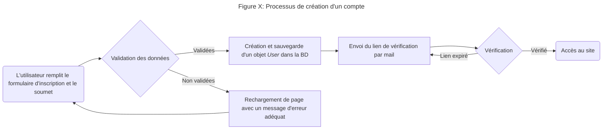
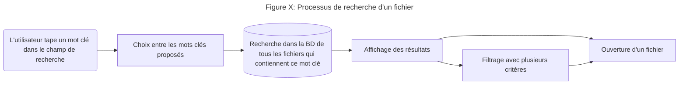

# La Caverne d'Ali Baba  <!-- omit from toc -->
**Alieldeen Ibrahim**  
Groupe 402

*COLLÈGE SISMONDI*, Travail de Maturité 2025-2027
Maître accompagnant : **Mathieu Schiess**

___

- [Introduction](#introduction)
- [Méthodologie](#méthodologie)
  - [Définition du projet et ses objectifs](#définition-du-projet-et-ses-objectifs)
  - [Choix des technologies](#choix-des-technologies)
    - [Django](#django)
    - [htmx et JavaScript](#htmx-et-javascript)
    - [Bootstrap et CSS](#bootstrap-et-css)
    - [PostgreSQL](#postgresql)
- [Réalisation](#réalisation)
  - [Publication des fichiers](#publication-des-fichiers)
    - [Organisation des données](#organisation-des-données)
    - [Point de vue utilisateur](#point-de-vue-utilisateur)
    - [Dans les coulisses](#dans-les-coulisses)
  - [Authentification utilisateur](#authentification-utilisateur)
    - [Inscription au site / Création d'un compte](#inscription-au-site--création-dun-compte)
      - [Point de vue utilisateur](#point-de-vue-utilisateur-1)
      - [Dans les coulisses](#dans-les-coulisses-1)
    - [Connexion et session](#connexion-et-session)
  - [Accès et téléchargement des fichiers](#accès-et-téléchargement-des-fichiers)
    - [Recherche d'un fichier](#recherche-dun-fichier)
  - [*Auto-suggestion* (suggestion semi-automatique)](#auto-suggestion-suggestion-semi-automatique)
    - [Filtrage et affichage des résultats](#filtrage-et-affichage-des-résultats)
    - [Affichage et téléchargement des fichiers](#affichage-et-téléchargement-des-fichiers)
- [La suite](#la-suite)

---

<br>

# Introduction

À travers mon parcours scolaire, j'ai fait face aux évaluations (et j'y fait encore), c'est malheureusement inévitable.

Un des problèmes que je rencontre lors de la revision est de ne pas savoir par où commencer, car certains enseignants distribuent soit beaucoup soit peu de fichiers qui consiste souvent en articles dont le lien entre eux n'est pas clair, c'est le cas pour la géographie et l'histoire. La solution évidente est d'avoir pris des bonnes notes, mais celle-ci n'est pas simple surtout quand le sujet ne m’intéresse pas, et il ne sert plus de s'attarder sur le passé quand le contrôle s'approche.

Un deuxième problème que je rencontre lors de la revision est de ne pas avoir assez d'exercices. Certains enseignants donne deux ou trois problèmes par sujet, c'est le cas pour la physique. D'autres sujets méritent toujours plus d'exercices même si on en a déjà fait mille, comme les intégrales en maths qui ne se résout pas toujours de la même manière. Une réponse peut être qu'un enseignant ne mettra pas de problèmes qu'on n'a jamais eu en cours. C'est généralement vrai, mais à mon avis s'exercer sur des questions qu'on n'a pas vu avant garde le cerveau frais, donne beaucoup plus de faciliter à faire les exercices qu'on a déjà vu et permet de voir d'autres manières de les résoudre. Toutefois, il faut aimer le sujet sinon cela devient vite fastidieux.

La solution que j'ai trouvée aux deux problèmes est la demande aux autres. À chaque évaluation, je demande toujours à mes camarades d'envoyer leurs notes, à ceux qui ont un autre enseignant de m'envoyer leurs fichiers, notes et exercices ou même à des anciens élèves. J'ai ensuite remarqué que je ne suis pas le seul à faire ceci. Voici un exemple : Le 2e semestre de la 3e année, nous avions un oral de physique et un autre d'application de maths pour les épreuves regroupées. À ce moment-là, un groupe WhatsApp ainsi qu'un drive Google ont été créés, dans le but de partage de fichiers et de l’entraide. Cette solution est bien sûr valable, mais selon les cas, on n'a pas toujours des camarades à contacter.

Je me suis donc posé la question suivante : N'existe-t-il pas de moyen de partage qui ne demande pas la connaissance et le contact de tout un tat de monde ? Après un peu de recherche, je n'en ai pas trouvé qui corresponde à mes besoins. Je connaissais déjà un site de partage de document qui s'appelle [*Scribd*](https://www.scribd.com), et il existe beaucoup d'autres. Les problèmes avec ce dernier est qu'il contient des fichiers très diverses, et surtout qu'il est payant (sauf si on y dépose 10 fichiers). En tant qu'étudiant, un site payant n'est pas de tout attirant.

Étant donné que la programmation m'intéresse bien, j'ai décidé de remédier moi-même à ce problème et de créer un site de partage de fichiers scolaires gratuit pour les étudiants du collège de Genève. Ce projet sert non seulement à répondre à un besoin scolaire, mais à m'apporter une experience plutôt complète de création de site web de A à Z, quelque chose d'assez important si on envisage une carrière dans l'informatique avec l'essor de l'IA.

---

# Méthodologie

Je suis un simple collégien de 17-18 ans. J'ai fait de la programmation depuis l'âge de 12 ans ; c'était la pandémie et je devais bien faire quelque chose de ma vie. Cependant, je n'ai jamais créé de projet de ma propre ingénierie. J'étais donc perdu lorsqu'il a fallu commencer le travail. Pour pouvoir trouver une piste vers lequel je vais me diriger, j'ai fait une recherche rapide sur internet sur comment planifier un projet informatique. J'ai trouvé un [post](https://www.reddit.com/r/learnprogramming/comments/mumrgn/how_to_plan_and_build_a_programming_project_a/) sur Reddit donnant des étapes pour ce faire. Je n'ai pas suivi toutes les étapes, mais j'en ai pris l'essence. Dans ce chapitre, je explique la démarche que j'ai prise afin de concevoir le site web, ainsi que les choix des outils pris.

## Définition du projet et ses objectifs

Au début, j'ai commencé par définir le *MVP* (*Minimum Viable Product*). Un *MVP* est la version la plus minimale d'un produit ou d'une fonctionnalité. Il s'agit d'implémenter seulement ce qui est nécessaire pour que l'application fonctionne bien et ensuite de commencer à l'améliorer. Le but est donc de concevoir le produit le plus rapidement possible afin de pouvoir le montrer au monde et ensuite d'avoir des retours. En bref, il s'agit d'une version provisoire, mais qui fonctionne bien.[^mvp]

[^mvp]: WIKIMEDIA. Minimum viable product. Wikipédia (en ligne). Disponible à l'adresse : [https://en.wikipedia.org/wiki/Minimum_viable_product](https://en.wikipedia.org/wiki/Minimum_viable_product)

J'ai défini le *MVP* de la manière suivante : un site web sur lequel les utilisateurs, qui sont les collégiens de Genève, peuvent partager/publier des fichiers scolaires. C'est l'essentiel du site. Ces utilisateurs doivent pouvoir créer un compte, se connecter et se déconnecter. Ceci permet d'identifier les utilisateurs et réguler l'accès au site. Les fichiers partagés doivent être accessible à tout utilisateur authentifié, à l'aide d'un système de recherche et de filtrage afin de trouver un résultat satisfaisant, et téléchargeable. Selon moi, cette définition permet de créer la version la plus minimaliste du site. Elle me donne un but vers lequel je m'oblige à m'orienter afin d'obtenir une version utilisable du site. Il y a certaines choses que je n'ai pas mis dans la définition, principalement tous ce qui concerne le style du site, car l'aspect fonctionnel du site est plus important que l'aspect visuel. Ceci ne signifie pas qu'il est futile ; un bon style du site améliore fortement l'experience utilisateur.

## Choix des technologies

### Django

Pour ce projet, je savais que je allais apprendre beaucoup de programmation. De ce fait, j'ai décidé de me rendre la tâche plus facile en choisissant Python comme langage principale, car c'est celui que je connais le plus. Ce choix a été pas mal controversé par mes amis, en me demandant pourquoi pas utiliser JavaScript. Leur question est tout à fait valide qui me met parfois le doute. JavaScript est un langage très populaire dans le monde du web sur lequel une quantité énorme de *frameworks* est basée (React, Vue, Angular, Svelte, etc.). Ma réponse est que je ne suis pas à l'aise avec JavaScript.

Pour Python, il existe 2 *frameworks* populaires : Django et Flask. Le choix s'est basé sur deux critères : les fonctionnalités proposées nativement et mon degré de familiarité avec celui-ci. Pour ce qui concerne fonctionnalité, Django intègre nativement plus de fonctionnalités que Flask. Avoir ces mêmes fonctionnalités dans Flask necessite l'installation et l'apprentissage des librairies en plus. Pour ce qui concerne mon degré de familiarité, je connaissais ni la syntaxe ni le système de Django, donc il faut regarder des vidéos et lire des articles. J'ai déjà utilisé Flask dans un cours d'informatique. Mon choix final est Django. Au-delà de ses fonctionnalités, j'avais envie d'apprendre Django, donc le choix n'a pas été tout à fait objectif.

### htmx et JavaScript

Certaines fonctionnalités du site nécessitent une interactivité sans rechargement. La solution fréquente est d'utiliser JavaScript. Si on a envie de mettre à jour une certaine information provenant de la BD[^bd] sur une page sans recharger la page, il faut envoyer des requêtes `HTTP` depuis JavaScript et traiter leurs réponses, ce qui ajoute de la complexité au code du site. Afin d'éviter ceci, j'utilise la libraire JavaScript `htmx`. Elle permet d'envoyer des requêtes `HTTP` directement à partir d'éléments HTML et de remplacer une partie de la page avec la réponse du serveur. Toutefois, JavaScript est utilisé pour les modifications qui ne font pas intervenir des requêtes `HTTP`.

[^bd]: Pour des raisons de brièveté et de légèreté de lecture, BD signifie base de données.

### Bootstrap et CSS

Au début, j'ai choisi d'utiliser Bootstrap, un *framework* CSS qui fournit des composants et des styles prédéfinis permettant de créer rapidement une interface, de manière générale et CSS pour les petites modifications. C'est choix qui m'a posé beaucoup de problèmes lors du développement du site, et que je regrette. J'ai découvert que Bootstrap me convient pas et ne possède pas tout ce dont j'ai besoin, donc je finis quand même par écrire plus de CSS que voulu, ce qui devient vite fastidieux. Il est très probable que je cesserai d'utiliser Bootstrap et commencerai à utiliser Tailwind, un autre *framework* CSS qui fournit des classes utilitaires et qui donne plus de contrôle que Bootstrap, dan les prochaines versions.

### PostgreSQL

Dés le départ, j'ai décidé de prendre PostgreSQL comme BD. À ce moment-là, c'était un choix arbitraire. Quand on m'a demandé "Pourquoi pas MySQL ?", j'ai répondu que je préfère les éléphants sur les dauphins.[^elephants] Au début de development, j'ai gardé SQLite, la BD par défaut avec Django, pour des raisons de simplicité. Quand il a fallu developper la fonctionnalité de recherche, j'ai découvert plusieurs outils utiles dans PostgreSQL. Je parle plus en profondeur de ses outils dans le sous-chapitre [Recherche d'un fichier](#recherche-dun-fichier).

[^elephants]: La mascotte de PostgreSQL est un éléphant. Celle de MySQL est un dauphin.

---

# Réalisation

Dans ce chapitre, j'explique comment j'ai implémenté le site web. Je présente les principales fonctionnalités : la publication des fichiers, l'authentification des utilisateurs et enfin l'accès aux ressources et leur téléchargement à travers le système de recherche.

## Publication des fichiers

La première fonctionnalité que j'ai implémenté est celle de la publication et partage des fichiers, car selon moi, il s'agit du cœur de l'application. C'est la fonctionnalité qui donne à l'utilisateur la possibilité de partager ses documents avec le monde.

Afin de comprendre certains éléments qui arrivent plus tard dans le rapport, il faut savoir comment Django gère la BD. Django utilise la technique d'*ORM* (*Object-relational mapping*) pour gérer les données. Dans cette technique, on associe les tables d'une BD à des classes, donc chaque colonne de la table est représentée par une propriété de la classe et chaque ligne de la table est représentée par une instance de la classe, d'où "*mapping*" dans *Object-relational mapping*. Cette technique ne fonctionne bien sûr qu'avec les langages de programmation orientée objet, ce qui est le cas de Python. La table d'une BD est appelée un modèle (*model* en anglais) dans le monde de Django. La technique d'*ORM* permet au développeur de pouvoir se concentrer sur seulement un langage lors de la conception de son projet au lieu de devoir s'occuper d'un autre, SQL, lui donnant une vitesse de production. De plus, les *ORMs* (*Object-relational mapper*)[^orm-orm] améliorent la sécurité en réduisant fortement le risque d'attaques du type *SQL injection*[^SQLi], et en évitant de faire un *Bobby Tables*[^bobby-tables]. Cependant, les requêtes générées avec un *ORM* peuvent être moins optimisées que celles en *Raw SQL*.

[^orm-orm]: Il est important de différencier *Object-relational mapping*, c'est-à-dire la technique, et *Object-relational mapper*, c'est-à-dire l'outil qui nous fait utiliser la technique.

[^SQLi]: Une attaque *SQL injection* se fait quand une personne malveillante tape du SQL dans un champ de saisie, et ensuite ce SQL est mis dans la requête SQL du programme à l'aide de la concaténation, ce qui fait une requête qui va lui donner accès aux données dans la base. Vous pouvez vous informer plus ici : [https://www.w3schools.com/SQl/sql_injection.asp](https://www.w3schools.com/SQl/sql_injection.asp)

[^bobby-tables]: En 2007, xkcd a publié un comic avec un personnage dont le prénom a effectué une attaque *SQL injection*. [https://xkcd.com/327/](https://xkcd.com/327/)


### Organisation des données

Tout d'abord, j'ai commencé par créer la BD. L'une des difficultés qui se pose lors de l'implémentation de cette fonctionnalité est celle de savoir et de décider quelles informations un utilisateur doit entrer avec le téléversement du fichier. Ces informations doivent être stockées dans la BD de manière structurée afin de pouvoir s'en servir plus tard pour la recherche des fichiers.

```mermaid
---
title: "Figure X: Schéma de la BD"
config:
  theme: redux-color
  look: neo
---
erDiagram
    direction LR
    USER {
        int id PK
        autres propriétés...
    }

FICHIER {
        uuid id PK
        int user_id FK
        int enseignant_id FK
        string name
        string file
        string thumbnail "vignette"
        int year "degré"
        string subject
        string type "évaluation, exercices, etc."
        string ecole
        boolean annotated
        text description
        int status "accepté, en attente, rejeté"
        datetime uploadDatetime
    }

    ENSEIGNANT {
        int id PK
        string name
        string ecole
    }

    TAG {
        int id PK
        string name
    }

    USER ||--o{ FICHIER : publie
    ENSEIGNANT ||--o{ FICHIER : concerne
    FICHIER }o--o{ TAG : possède
```
<br/>

**On** peut voir dans ce diagramme[^diagram] toutes les relations entre modèles dans la BD. Quand un *user* publie des fichiers, en mentionnant l'enseignant concerné, plusieurs relations sont établies dans la BD. La relation entre `User` et `Fichier` et celle entre `Enseignant` et `Fichier` s'appellent des relations *one-to-many* (un-à-plusieurs) ; un utilisateur peut avoir plusieurs fichiers, mais un fichier n'appartient qu'à un utilisateur. On associe à chaque fichier un ou plusieurs *tags* (mots clés), qui aident plus tard à la recherche de ces documents. Cette relation s'appelle *Many-to-many* ; un *tag* peut être associé à plusieurs fichiers et un fichier peut avoir plusieurs *tags*. Il est important de savoir que pour avoir une relation *many-to-many* (plusieurs-à-plusieurs), il y a besoin d'une table de plus qui n'a pas de modèle associé, elle sert juste de pont entre les deux. Cette table est créée par défaut par l'*ORM* de Django, mais on peut aussi créer la sienne.

[^diagram]: Le markdown écrit pour concevoir ce diagramme a été créé le 13 septembre 2026 à l'aide de ChatGPT. Le fichier contenant les modèles lui a été donné afin qu'il me donne le markdown nécessaire. J'ai ensuite modifié selon mes besoins le diagramme.

Pour les écoles, matières, types de fichier et années, je n'ai pas créé de modèle. J'ai utilisé des *enums*[^enum], car ces valeurs sont toujours constantes, ne changeront jamais, et il n'y en a pas beaucoup. Pour les enseignants, j'ai prévu d'utiliser ce même outil. Cependant, j'ai dû faire un modèle `Enseignant` car je ne possède pas de liste contenant tous les enseignants de tous les collèges de Genève. À chaque publication d'un fichier, un enseignant ne figurant pas déjà dans la BD est ajouté. Ceci signifie qu'avec un grand nombre d'utilisateurs et de fichiers téléversés sur le site, je peux avoir une telle liste.

[^enum]: "En programmation informatique, un type énuméré (appelé souvent énumération ou juste enum, parfois type énumératif ou liste énumérative) est un type de données qui consiste en un ensemble de valeurs constantes. Ces différentes valeurs représentent différents cas ; on les nomme énumérateurs. Lorsqu'une variable est de type énuméré, elle peut avoir comme valeur n'importe quel cas de ce type énuméré." [WIKIMEDIA. Type énuméré. Wikipédia (en ligne). Disponible à l'adresse : [https://fr.wikipedia.org/wiki/Type_%C3%A9num%C3%A9r%C3%A9](https://fr.wikipedia.org/wiki/Type_%C3%A9num%C3%A9r%C3%A9)]

### Point de vue utilisateur

<!-- IMAGES
Fichiers: pub_1.png, pub_2.png, pub_3.png, pub_4.png, pub_5.png, pub_6.png
Disposition: grille 2 colonnes × 3 lignes
Ordre: de gauche à droite, puis de haut en bas
Légende générale: Figure X: Étapes de publication d'un fichier sur le site.
Sous-légendes:
1. Accès à la page de publication
2. Sélection d'un fichier
3. Dépôt du fichier PDF
4. Affichage du formulaire
5. Saisie des informations
6. Publication du fichier
-->

Au début, j'envisageait le formulaire de publication différemment. Je pensais mettre tous ses champs à la suite sans qu'il y aie de séparation ou de transition. Après avoir montré à certains de mes amis et avoir regardé des inspirations en ligne, j'ai aperçu que cette mise en page est assez lourde. Je l'ai ensuite refaite telle qu'elle est dans la figure X. J'ai implémenté la méthode glisser-déposer (*drag and drop*) qui est fréquemment utilisée dans les sites où il faut un dépôt de fichier. Elle permet une certaine fluidité au site. L'utilisateur peut tout de même charger un fichier en cliquant dans le carré. Ensuite, l'utilisateur remplie le reste du formulaire et le soumet. À la fin, il retourne à la page d'accueil.

<!-- IMAGE
Fichier: pub_error.png
Légende: Figure X: Exemple de validation du formulaire lorsqu’un champ obligatoire n’est pas renseigné
Disposition: à droite, inclus avec le reste du texte
-->
Comme on peut dans la figure X, un message apparaît rappelant l'utilisateur de remplir le champ en cas d'oubli.

<!-- IMAGE
Fichier: pub_supposed.png
Légende: Figure X: Maquette conçue pour l’interface de publication avant son implémentation
Disposition: à droite, inclus avec le reste du texte
-->
L'espace vide à droite qu'on voit dans la figure X-2 est censé être remplacer par une carte, qu'on peut voir dans la figure X, montrant à quoi ressemblera le fichier dans les résultats d'un recherche. Le carré vide dans la carte sera remplacé par une vignette du fichier. Ceci est en cours de développement.

### Dans les coulisses

<br/>

Le processus de publication d'un fichier est très simple grâce à Django. Quand un utilisateur partage un fichier, la validation des données, c'est-à-dire la vérification qu'elles sont bien remplies et du bon type, est effectuée par Django qui regarde les critères qui ont été déclarés lors de la création du modèle. De plus, la création d'un objet `Fichier` ainsi que son lien avec la BD sont assurés par l'*ORM* de Django.

Tous les fichiers et leurs vignettes sont stockés sur un bucket AWS S3. Le stockage des documents sur un tel service permet une séparation de tâches où le serveur s'occupe seulement du programme et de la conservation des métadonnées des fichiers dans la BD et le service s'occupe de la conservation des fichiers. Cette organisation allège le travail du serveur, car leur téléchargement ne nécessite pas de transit à travers le serveur. Plus encore, en cas d'augmentation du nombre de serveurs hébergeant l'application, ils pourront tous communiquer avec le service au lieu de chercher dans chacun où se trouve un certain fichier.

## Authentification utilisateur

La deuxième fonctionnalité que j'ai décidé d'implementer est l’authentification utilisateur. L'authentification utilisateur est très importante pour l'application car elle permet de vérifier si l'utilisateur est bien un étudiant du Collège de Genève et de lui autoriser l'accès. Ainsi, l'utilisateur doit pouvoir créer son propre compte, vérifier son adresse mail, se connecter afin de s'authentifier et pouvoir accéder à la caverne.

Un des avantages de Django est son système d'authentification. Django possède déjà un modèle `AbstractUser` qui contient toutes les propriétés nécessaires pour sauvegarder un utilisateur, telles que l'identifiant et le mot de passe, et auquel j'ai ajouté une propriété `ecole` qui contiendra le collège auquel appartient l'utilisateur.

### Inscription au site / Création d'un compte

#### Point de vue utilisateur

<!-- IMAGES
Fichiers: in_1.png, in_2.png, in_3.png, in_4.png, in_5.png, in_6.png, in_7.png
Disposition: processus en 7 étapes, grille compacte adaptée à la page
Ordre: de gauche à droite, puis de haut en bas
Légende générale: Figure X: Étapes de création d'un compte sur le site.
Sous-légendes:
1. Accès à la page d'inscription depuis la page de connexion.
2. Formulaire de création d'un compte.
3. Saisie des informations et envoi du formulaire.
4. Demande de vérification de l'adresse eduge.
5. Réception du courriel contenant le lien de vérification.
6. Confirmation de la vérification du compte.
7. Accès au site après vérification.
-->
Les étapes de création d'un compte sont simples et directes. Étant donné que c'est une fonctionnalité présente dans quasiment toutes les applications et elle est toujours implémentée de la même manière, il n'y a pas eu beaucoup de réflexion à faire concernant le fonctionnement général de l'inscription. J'ai regardé comment ces applications la gère et je l'ai recrée dans le site, car un changement peut confondre les utilisateurs.

<!-- IMAGES
Fichiers: in_id.png, in_pass.png
Disposition: 2 images côte à côte.
Légende générale: Figure X: Exemples de validation des données lors de la création d'un compte.
Sous-légendes:
1. Refus d'un identifiant eduge déjà utilisé.
2. Refus d'un mot de passe ne respectant pas les critères de sécurité.
-->
La figure X.1 nous montre le message d'erreur qui apparaît lorsqu'on essaie de s'inscrire avec un identifiant déjà utilisé. Ceci évite des potentielles conflits dans la BD.

La figure X.2 nous montre le message d'erreur qui apparaît lorsqu'un utilisateur utilise un mot de passe court. Avoir une longueur minimale protège les utilisateurs contre les attaques par force brute.

La vérification par mail est une méthode de confirmation d'identité qui sert principalement à s'assurer que la personne qui est en train de créer le compte est bien la personne qu'elle prétend être et à éviter toute tentative de fraude ou d'usurpation d'identité. Toutefois, j'ai décidé de l'implementer car elle sert à vérifier que la personne possède bien un compte eduge, puisque le programme envoie le mail de vérification à `<identifiant eduge saisi>@eduge.ch`. Il existe donc 3 possibilités suite à la soumission de formulaire:
1. la personne s'est inscrite avec un identifiant eduge invalide. Elle ne recevra jamais le mail et ainsi n'aura jamais accès au site.
2. la personne s'est inscrite avec un identifiant eduge valide mais qui ne lui appartient pas. Elle n'a normalement[^verify-2] pas accès au mail, donc elle n'aura pas accès au site.
3. la personne s'est inscrite avec un identifiant eduge valide lui appartenant. Elle pourra donc cliquer sur le lien de vérification envoyé et ensuite accéder au site.

[^verify-2]: Je dis "normalement" car elle peut y avoir accès à cause d'une cyberattaque, mais ceci ne nous concerne pas.

<!-- IMAGE
Fichier: ver_expired.png
Légende: Figure X: Message affiché lorsqu'un utilisateur tente d'utiliser un lien de vérification expiré.
Disposition: à droite, inclus avec le reste du texte
-->
Le lien de vérification est valide pendant 24 h avec la possibilité d'en générer un autre afin de donner quand même une chance en cas d'oubli (Figure X). Ce qui assure l'unicité du lien, c'est que son *token* dépend d'une certaine information de l'utilisateur, du temps et de la clé secrète de l'application[^secret-key].

[^secret-key]: "La clé secrète d’une installation Django. Elle est utilisée dans le contexte de la signature cryptographique, et doit être définie à une valeur unique et non prédictible." [DJANGO SOFTWARE FOUNDATION, 2026. Réglages. Django (Version 6.1) (en ligne). Disponible à l'adresse : [https://docs.djangoproject.com/fr/6.1/ref/settings/#std-setting-SECRET_KEY](https://docs.djangoproject.com/fr/6.1/ref/settings/#std-setting-SECRET_KEY)]

#### Dans les coulisses


<br/>

De même que pour le processus de publication d'un fichier, le processus de création d'un compte bénéficie du système de formulaire de Django. Ainsi, la validation des données, qui consiste à vérifier l'unicité de l'identifiant et la sécurité du mot de passe, est effectuée par Django ainsi que la création du compte et sa sauvegarde dans la BD. Il est important de savoir que Django ne stocke pas les mots de passe en tant que tels, mais les stocke hachés, pour garantir leur sécurité au sein de la BD.

### Connexion et session

La connexion et la session sont gérées par Django sans grande modification ou ajout de ma part. Une session, qui est créée suite à la connexion d'un utilisateur, me permet de pouvoir lier l'utilisateur qui a publié un fichier au fichier publié. De plus, elle maintient la connexion de l'utilisateur même après la fermeture de l'onglet.

<!-- IMAGES
Fichiers: con_1.png, con_2.png, con_3.png
Disposition: séquence de 3 images montrant le processus de connexion.
Légende générale: Figure X: Étapes de connexion au site.
Sous-légendes:
1. Formulaire de connexion.
2. Saisie de l'identifiant eduge et du mot de passe.
3. Accès au site
-->
Pareillement à la création du compte, la connexion a été implémenté de manière conventionnelle pour que l'experience utilisateur soit la même que la majorité des applications et pour éviter des confusions.

<!-- IMAGES
Fichiers: con_pass.png, con_verify.png
Disposition: 2 images côte à côte.
Légende générale: Figure X: Exemples de validation des données lors de la connexion de l’utilisateur.
Légende: Figure X: Message affiché lorsqu'un utilisateur tente de se connecter avec un identifiant non existant ou un mot de passe incorrecte.
Sous-légendes:
1. Refus d'un identifiant non existant ou un mot de passe incorrecte.
2. Refus de la connexion lorsque les identifiants sont corrects, mais que le compte n'a pas encore été vérifié par mail.
-->
En cas de saisie de mauvaises informations, l'utilisateur voit le message dans la figure X.1.

En cas de non verification du compte, l'utilisateur voit le message dans la figure X.2. C'est ici que la verification utilisateur devient importante. Tant que l'utilisateur n'a pas validé le lien reçu sur son adresse eduge, le site ne peut pas confirmer qu'il a accès à cette adresse et lui refuse donc la connexion.


## Accès et téléchargement des fichiers
Suite à la publication des fichiers, il est important que l'utilisateur puisse y accéder et les télécharger ; c'est l'objectif de l'application. Cependant, avec l'augmentation du nombre de fichiers (ce qui, je l’espère, va arriver) sur l'application, il devient presque impossible de trouver ce que l'on veut. Afin de résoudre ce problème, il faut mettre un système de recherche efficace qui permettra à l'utilisateur de trouver ce dont il a besoin sans problème. C'est ici qu'on se sert de l'organisation des données dans la BD (cf. [Publication des fichiers](#publication-des-fichiers)).


### Recherche d'un fichier

<br/>

Quand l'utilisateur ouvre le site, en s'étant déjà connecté, il trouve directement la barre de recherche devant lui, ce qui lui facilite la tâche, car il n'a pas à la chercher ailleurs. Pour chercher ce dont il a besoin, l'utilisateur écrit des mots clés, les mêmes qui ont été inscrits lors de la publication.[^search]

[^search]: Cette section est écrite le 17 septembre 2026. Le système de recherche actuel est susceptible de changement. Les raisons seront écrites suite au changement.

## *Auto-suggestion* (suggestion semi-automatique)
L'*auto-suggestion* est une fonctionnalité qui "prédit" et montre à l'utilisateur des fins possibles à ce qu'il est en train d'écrire lors de sa recherche. Elle lui permet de gagner en rapidité et rend sa requête plus précise. Dans l'application, cette fonctionnalité est possible grâce à PostgreSQL. Dans PostgreSQL, il est possible de faire une recherche par *Trigram similarity*[^trigram] à l'aide du module `pg_trgm`, ce qui rend la tâche très fluide. Étant donné que la langue française fait usage des accents, il est important que les résultats ne dépendent pas de leur présence, car les accents ne sont pas toujours mis lors de la recherche. Pour ce faire, il existe un autre module `unaccent` dont la seule fonction est d'enlever les accents. Ces 2 modules sont propres à PostgreSQL.

[^trigram]: "A trigram is a group of three consecutive characters taken from a string. We can measure the similarity of two strings by counting the number of trigrams they share. This simple idea turns out to be very effective for measuring the similarity of words in many natural languages." [POSTGRESQL. pg_trgm — support for similarity of text using trigram matching. PostgreSQL (en ligne). Disponible à l'adresse : [https://www.postgresql.org/docs/current/pgtrgm.html](https://www.postgresql.org/docs/current/pgtrgm.html)]

Bien souvent, l'utilisateur peut changer le contenu de la barre de recherche. Dans ces situations, il serait quand même assez préférable que les suggestions changent aussi, pour donner une sensation de dynamisme à l'utilisateur, et quand on parle de dynamisme, JavaScript apparaît. Or, je n'aime pas JavaScript, car je ne suis pas à l'aise avec lui et je trouve sa syntaxe vraiment immonde. C'est ici qu'apparaît htmx. htmx (en minuscules) est une librairie qui me permet de déclencher des requêtes `HTTP` à partir d'attributs HTML, sans avoir recours à JavaScript. Dans le cas de cette application, htmx envoie une requête à Django avec le contenu de la barre de recherche, Django fait sa magie[^magie] et envoie un fragment de HTML avec les résultats (qui sont les suggestions), et htmx le remplace directement dans le *DOM*[^dom] au lieu de recharger la page, le tout à l'aide d'attributs HTML. Sans htmx, il aurait fallu coder la détection de la modification de la barre de recherche, l'envoi de la requête, la récupération de la réponse et la modification du *DOM* pour afficher les nouveaux résultats.

[^dom]: "Le Document Object Model (DOM) est une interface de programmation pour les documents web. Il représente la page de façon à ce que des programmes puissent modifier la structure, le style et le contenu du document. Le DOM représente le document sous forme de nœuds et d'objets ; ainsi, les langages de programmation peuvent interagir avec la page." [MOZILLA. Document Object Model (DOM) (en français). MDN Web Docs (en ligne). Disponible à l'adresse : [https://developer.mozilla.org/fr/docs/Web/API/Document_Object_Model](https://developer.mozilla.org/fr/docs/Web/API/Document_Object_Model)]

[^magie]: Ce n'est bien sûr pas de la magie, il s'agit d'une requête faite par Django dans la BD avec *Trigram Similarity*.

### Filtrage et affichage des résultats
Quand l'utilisateur choisit enfin le mot clé souhaité, la requête est envoyée à Django qui cherche ensuite dans la BD une liste des fichiers possédant ce mot clé dans leur propriété `tag`. La liste des fichiers est affichée à l'utilisateur sous forme de carte, qui contient une vignette du fichier (qui a été créée lors de la publication).

Voici un exemple de la manière dont ceci peut se passer : un utilisateur peut chercher "géométrie vectorielle", et il aura comme résultats plusieurs fichiers qui ont ceci comme sujet. Cependant, notre cher utilisateur est un étudiant de 2e année, et la géométrie vectorielle est aussi abordée en 3e année[^geo-vec]. Comment fait-il pour ne pas tomber sur des fichiers qui, a priori, ne lui sont pas intéressants ? C'est pour cette raison qu'il y a des filtres, comme l'école, le degré et le type de fichier, qui sont mis en place et qu'on peut choisir afin de raffiner les résultats et de trouver ce qui nous convient. htmx est aussi utilisé ici de la même manière qu'avant : à chaque ajout ou enlèvement de filtres, htmx envoie la requête et remplace les résultats au lieu de recharger la page.

[^geo-vec]: C'est le cas à Sismondi de toute manière.

### Affichage et téléchargement des fichiers
Un utilisateur peut voir plus d'informations sur un fichier ainsi que son contenu en cliquant sur la carte qui le représente. Pour afficher le contenu d'un fichier, le lecteur PDF par défaut du navigateur est utilisé. Dans ce lecteur, il y a l'option de télécharger le fichier.

---

# La suite
Maintenant que le site web fonctionne de manière basique et est en ligne, il reste encore plusieurs choses que j'ai envie de faire et d'implémenter. Voici une liste non exhaustive :
- Travailler sur le design du site
- Changement de mot de passe
- Repenser le système de recherche actuel
- Faire tester le site web par d'autres élèves
- etc.

J'essaie toujours de réfléchir à différentes manières d'améliorer le site web.
